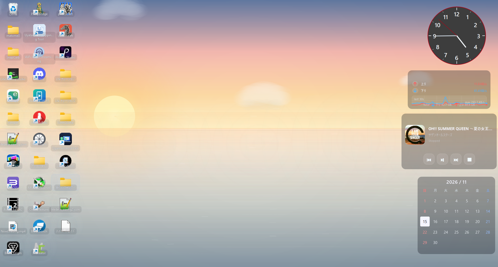
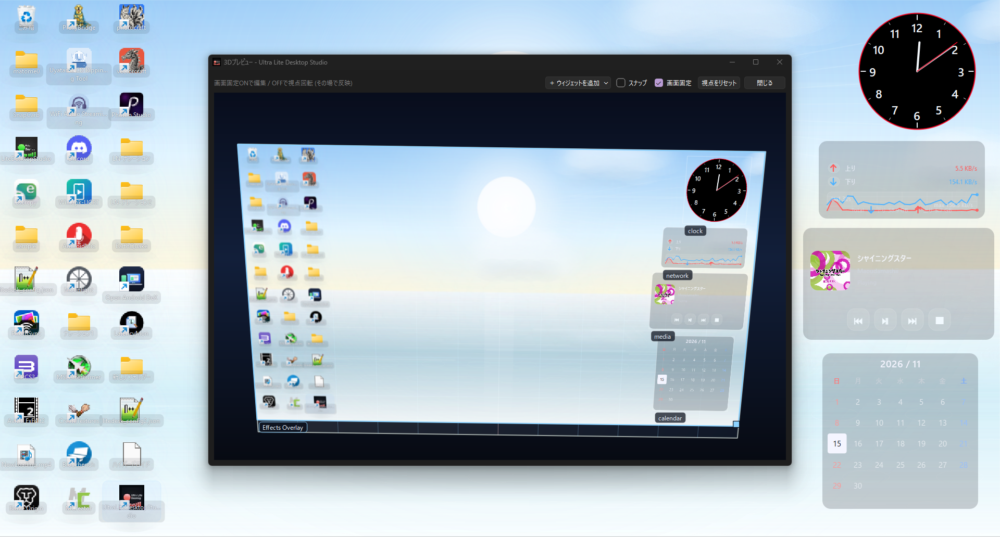

# Ultra Lite Desktop Studio

(旧称: [LiteDesktopStudio](https://github.com/CrossDarkrix/LiteDesktopStudio)
「Ultra Lite Desktop Studio」に変更。設定ファイル名など内部の互換名は不変)

Python / PySide6 版 LiteDesktopStudio を、Core i5 級の低スペック機でも常駐できるように
C++17 / Qt6 Widgets で作り直した軽量版です。

## スクリーンショット





## 軽さの仕組み

- Qt **Widgets のみ**。WebEngine (Chromium)・OpenGL・numpy・psutil・soundcard・pycaw・winsdk は不使用
- 全画面キャンバス (45fps 常時再描画) を廃止し、**ウィジェット毎の小窓**にした。
  再描画は自分の矩形だけ、表示内容が変わった時だけ
- 共有タイマーは **1秒に1本**だけ。ビジュアライザーだけ 30fps の専用タイマーを持ち、
  無音時は再描画を止める
- システム情報は Win32 API 直接取得 (CPU `GetSystemTimes` / メモリ `GlobalMemoryStatusEx` /
  ディスク `GetDiskFreeSpaceExW` / 通信 `GetIfTable2`)
- 音声は WASAPI ループバック + 自前 FFT (2048点) を専用スレッド1本に限定

## 対応ウィジェット

v0.1: clock / system / network (履歴グラフ) / calendar / html (テキスト) /
visualizer (WASAPI) / volume (Core Audio、ホイール・ミュート対応) / media (メディアキー)
v0.2: **weather を実装** (wttr.in、10分間隔、3日予報つき)
v0.5 (part 1): **effects_overlay を実装** — 雨・雪（結晶つき）・月・雲・水面・氷面。
QPainter のみ・24fps・ウィジェットが存在する時だけ生成される。
特殊シーン4種（ウユニ塩湖 / 父母ヶ浜 / パムッカレ / サハラ）は part 2。
v0.6: **visualizer を本格化** — 設定キー (visualizer_*) を実際に読むようにした。
共通設定も反映: 上下反転・縦向き・ピーク ON/OFF・グロー・影 (オフセット/不透明度/
強さ/深さ/ぼかし近似)・バーの太さ・フレームレート (Python 既定60fps は上限30にキャップ)。
ビジュアライザーの右クリックメニューからスタイルと各トグルをその場で変更できる。
v0.8.0: **特殊シーン4種を実装 (エフェクト part 2)** — ウユニ塩湖 / 父母ヶ浜 /
パムッカレ / サハラ砂漠。静止画レイヤーはキャッシュした pixmap 1 枚
(再生成はリサイズ時のみ)、毎フレームの仕事はグラデーションと線と blit だけ。
時刻連動の空 (夜明け/昼/夕方/夜の4フェーズ、太陽グロー・星・流れ星・月) を
3シーンで共有し、ウユニと父母ヶ浜は雲の鏡映 (反転ではなく 0.52 圧縮+揺らぎ)
と大気レイヤー (霧+水面の屈折ゆらぎ) つき。父母ヶ浜は時刻アクセント
(夜は月の反射の細線など) と 2 秒毎のきらめき、パムッカレは段丘の relief
静止画 + 2 秒毎の sheen、サハラは砂丘4層の静止画 + 転がる枯れ草。
Python の激重ポイント (雲の反射側再レンダリング、大気画像の 5 回/秒再生成)
は blit と直接描画に置き換えた。あわせて雲 pixmap を積雲状に改良
(従来は縁で切れて四角い輪郭が出ていた)。
v0.15.2: **JSHTML の上書きインポートで旧新が交互表示される致命的
不具合を修正** (報告) — 仮想ホスト名 "lds.local" を全ビューで
共有していたのが原因。WebView2 のホスト→フォルダ対応は
「最後に登録したビューが勝ち、既存ページは旧対応のまま残る」
挙動のため、複数ビューがある状態で上書きすると、旧ビューが
毎秒の再読込チェックで他人のフォルダのファイルを同じ URL で
取得しに行き、旧パッケージと新パッケージが交互に表示された。
ホスト名をウィジェット毎に分離 ("lds-<instanceId>.local") し、
ナビゲーションと listAssets/getLocalAssetUrl の URL も追随。
WebEngine バックエンドはビュー毎に baseUrl が独立なため無関係。
v0.15.1: **編集モードでエフェクトを触れないように** (依頼) —
エフェクトは全画面キャンバスなので、編集モード中の誤ドラッグで
画面全体がズレてしまう。編集モードではエフェクトへのドラッグ/
リサイズを開始しないようにした。ついでに Delete 対策として、
エフェクトは選択対象にもならない (クリックすると選択が外れる
だけ) ようにした。全画面を覆っているため、普通のデスクトップ
クリックで選択されて Delete で消える事故も防げる。右クリック
メニューからの削除は従来通り可能。
v0.15.0: **キーボードショートカットを追加** (依頼) — 「E」キーで
編集モードに入る/出る、編集モード中は最後にクリックしたウィジェット
(=選択中、枠が太い実線になる) を Delete キーで削除できる。
ウィジェット窓はフォーカスを取らないため Windows では低レベル
キーボードフック (WH_KEYBOARD_LL、観察のみでキーは横取りしない) で
検出する。ただし素の「E」は文字入力と衝突するため、発動条件を
厳しく絞った: 修飾キー無し、かつ前面が自プロセス/デスクトップ/
タスクバーのいずれか、かつ自プロセス内でもテキスト入力欄に
フォーカスがある時は無効。これ以外の場面 (ブラウザやエディタで
入力中など) では E を押しても何も起きない。Linux では無効
(Windows 専用機能として実装)。
v0.14.9: **JSHTML パッケージの画像が表示されない不具合を修正** (報告、
snow_crystal_fall サンプル) — listAssets / getLocalAssetUrl が返す
url が Python 版互換の file:// だったが、ページは仮想ホスト
https://lds.local 上で動いており、Chromium は https ページからの
file:// サブリソースをブロックする (Python 版はページ自体が
file:// だったので通っていた)。返す URL を仮想ホスト側
(https://lds.local/assets/...、パーセントエンコード済み) に変更。
相対パス計算は Windows のドライブレターで QDir::relativeFilePath が
壊れるため、絶対パスの前方一致で自前に変更 (単体テストで確認)。
WebEngine バックエンドはページが file:// なので従来のまま。
v0.14.8: **JSHTML のオーディオ反応をもっさりから 20fps に** (報告) —
コパイロット製サンプル (Audio Reactive Bars) の動きがもっさり。
サンプルは LDS.getAudioSpectrum() を 50ms 間隔でポーリングするが、
その API は「最後に push された状態」から返す作りで、push が
本体の 1 秒ティックだけだったため実質 1fps のデータになっていた。
対策: 音声エンジン動作中だけ、JSHTML へ音声だけの状態を 50ms
(20fps、ネイティブのビジュアライザと同じレート) で追加 push する
タイマーを JsHtmlWidget に追加。音声が止まればタイマーも止まる
ので待機コストはゼロ。プラグイン側の状態保持は「置換」から
「マージ」に変更 (音声だけの push で CPU/メモリ値が消えないため)。
計測用パッケージで検証: 50ms ポーリング 139 回中、異なる
スナップショット 138 件 = 約 23/s (エンジン側の生成レートで頭打ち)。
サンプルの Anime Sidebar / Audio Bars は無改造で動作。
v0.14.7: **JSHTML の透明度 0% で操作不能になる不具合を修正** (報告) —
JSHTML はプラグインのビューが全面を覆いページ自体が透過なので、
bg_alpha がページ越しにそのまま効く。他ウィジェットは中身 (文字や
アイコン) が不透明で残るが、JSHTML は 0% で完全に消え、半透明
ウィンドウのピクセル単位ヒットテストでクリックも届かなくなり、
右クリックで戻すこともできなくなっていた。対策: (1) html_js を
透明度メニューの対象から除外 (エフェクトと同じ扱い。ページの背景は
HTML 側で制御する)。3D プレビューの右クリックも同じ経路なので
同時に塞がれる。(2) 既に 0% で保存されてしまった html_js は、
起動時に既定の 155 へ自動で戻す救済を入れた。
v0.14.6: **文字化けの真因を修正** — v0.14.5 の charset 対策でも実機は
文字化けのまま。真因はデータ側: 既定 HTML の文字列リテラルを
QString::fromLatin1() で読み込んでいた。ソースは UTF-8 なので、
日本語バイト列が Latin-1 として解釈され、書き出し時に二重符号化
されて文字化けがデータに焼き込まれていた (charset をどう直しても
直らない)。両バックエンドとも fromUtf8() に変更。実文字列での
往復テストで fromLatin1=化ける/fromUtf8=正常 を確認。なおユーザー
自身の HTML (config の JSON 経由) は元々 UTF-8 で正しく、化けるのは
内蔵の既定ページだけだった。v0.14.5 の ensureCharset は HTTP
charset 無し配信への保険として残置 (実害なし)。
v0.14.5: **JSHTML の日本語文字化け対策 (第1弾・charset 位置)** —
WebView2 バックエンドが実機で描画成功。ただし日本語が文字化け。
仮想ホスト配信には HTTP の charset が無く、<meta charset> は文書先頭
約1024バイト以内でないと Chromium に無視される仕様で、既定文書は
<style> が長く宣言位置が後ろに流れていた。ensureCharset() を追加:
既存の charset 宣言を除去し、<head> の直後に必ず再挿入する
(head 無し文書にも対応、冪等)。inline とパッケージエラー文書、
WebEngine バックエンドの文書組み立てにも適用。単体テスト5件
(埋没した宣言の救出/冪等性/head無し/断片/http-equiv形式) 全通過。
注意: パッケージモードの entry HTML はファイルがそのまま配信される
ため、パッケージ側の HTML 自身に <meta charset="utf-8"> を先頭近くに
書く必要がある。
v0.14.4: **プラグインのファイル名不一致を修正 (実機で原因確定)** —
実機では libLdsJsHtml.dll が生成されていた。MinGW では DLL 名に
GNU 式の "lib" 接頭辞が付くのが既定で、本体が探す LdsJsHtml.dll と
一致せず読み込みに失敗していた (こちらの手作業 DLL ビルドでは接頭辞が
付かず混入)。対策は二重: (1) CMake のプラグインに PREFIX "" を指定し、
生成名を LdsJsHtml.dll に統一。(2) 本体の読み込み側も lib 付きの名前を
フォールバックで試すようにし、既にビルド済みの libLdsJsHtml.dll でも
そのまま動く。Linux で両経路とも E2E (ping=pong) を確認。
v0.14.3: **プラグインが読み込めない理由をその場で表示** — 実機で
ビルドは通ったがプレースホルダ (プラグイン無し表示) になったため、
QLibrary のエラー文字列 (DLL 自体が無いのか、依存 DLL が足りないのか等)
と不足シンボル名を、プレースホルダ内とデバッグログの両方に出すように
した。推測で直すのをやめ、次回は表示された一文で原因が確定する。
なお Windows バックエンドは WebView2 のため qt6-webview / qt6-webchannel
は無関係 (入れても害はない)。
v0.14.2: **MSYS2 実機ビルドエラーの修正** — MSYS2 環境で
WebView2.h が 'EventRegistrationToken' has not been declared で停止。
同梱シム EventToken.h が MinGW の <eventtoken.h> へ転送する方式だったが、
このヘッダーセットではその中身が有効にならなかった (こちらの検証用
MinGW には在ったため混入に気づけなかった)。シムを自己完結化:
SDK と同一レイアウト (int64 の value 1個) の struct を自前で定義し、
WIDL 生成ヘッダーと同じ __eventtoken_h__ ガードを立てて、後から
MinGW 本家ヘッダーが読まれても再定義にならないようにした。検証は
システム側 eventtoken.h を隠した状態 (=この環境を再現) で
プラグイン全コードのコンパイル+DLL リンク+公開シンボル4点を確認。
v0.14.1: **JSHTML の Windows バックエンドを WebView2 に変更** (選択)。
v0.14.0 納品時に案内した MSYS2 の mingw-w64-ucrt-x86_64-qt6-webengine は
**存在しなかった** (案内ミス)。Chromium は MinGW GCC でビルドできないため
MSYS2 の GCC 系環境 (UCRT64/MINGW64) に Qt WebEngine は収録されておらず、
代替に挙がった qt6-webview は QWebChannel も Widgets ビューも無い別物で
使えない。そこで Windows では Qt WebEngine をやめ、Windows 11 に標準で
入っている **Microsoft Edge WebView2 ランタイムを COM API で直接駆動**
するバックエンドに作り替えた:
- プラグイン LdsJsHtml の中身だけ差し替え。本体・C ABI・設定 JSON・
  状態 push は不変で、本体は引き続きブラウザエンジンにリンクしない。
  非 Windows では従来の Qt WebEngine バックエンドが残る (開発用)
- SDK (Microsoft.Web.WebView2 1.0.4314.35) のヘッダーと x64 の
  WebView2Loader.dll を third_party/webview2/ に同梱。ローダーの
  import lib は MSVC 専用なので DLL から動的に解決する。MinGW 特有の
  対応が2つ: EventToken.h の大文字小文字シムと、__uuidof の明示的
  特殊化 (GUID 値は SDK の IID_ 定数と照合済み)
- JS ブリッジは QWebChannel の代わりに chrome.webview のメッセージ
  パッシング。ブートストラップは AddScriptToExecuteOnDocumentCreated
  で注入し、window.LDS / LDSReady / System.Gadget の表面は WebEngine
  版と同一に保ったので、ウィジェットの HTML は無改造で動く
- ページは仮想ホスト https://lds.local/ にウィジェットフォルダを
  マップして読み込む (inline は data/lds_inline.html に書いてから)。
  右クリックは標準メニュー無効化+捕捉リスナーで座標を本体へ送り、
  本体の通常メニューを開く
- WebView2 由来の差分: 編集モード中はページを隠す (ネイティブ子
  ウィンドウはマウス透過にできないため。本体のパネルが表示される)。
  ユーザーデータフォルダは %LOCALAPPDATA%/UltraLiteDesktopStudio/
  WebView2 (WebView2 はフォルダ必須のため)。背景透過は
  ICoreWebView2Controller2 の DefaultBackgroundColor で指定
- 検証範囲 (正直な線引き): この環境には Windows が無いため実機の
  描画確認はできていない。代わりに、MinGW クロスコンパイラ+公式
  MinGW 版 Qt 6.8.3 ヘッダーでプラグイン全コードのコンパイルと
  DLL リンク、公開シンボル4点の確認まで行った。COM ハンドラの
  パターン単体も先行してコンパイル検証済み。Linux 側 (WebEngine
  バックエンド) の E2E は従来通り全通過。実機での初回確認ポイントは
  README 末尾ではなく本節: (1) JSHTML ウィジェット追加で既定ページが
  出るか (2) ボタンのクリックで時刻が変わるか (3) 右クリックで本体
  メニューが出るか (4) 編集モードでページが隠れ、戻すと再表示されるか
v0.14.0: **JSHTML を実装** (任意コンポーネント方式) — 設計の要点は「本体は WebEngine に一切リンクしない」:
- 本体 exe は WebEngine をリンクせず、html_js ウィジェットが初めて現れた
  時だけ QLibrary でプラグイン **LdsJsHtml** (WebEngine をリンクする唯一の
  部品) を読み込む。html_js が無ければ Chromium の子プロセスは 0 個で
  プラグイン自体もメモリに載らない (Linux で /proc の maps と子プロセス
  数で検証済み)。プラグインが無い環境では説明プレースホルダに劣化する
- Python版 (litedesktopstudio/jshtml.py) と同仕様: 設定キー
  (jshtml_mode / jshtml_entry / jshtml_package_name /
  jshtml_package_version / jshtml_permissions_json / jshtml_instance_id)、
  ウィジェット置き場 ~/LiteDesktopStudio_jshtml_widgets/<instance_id>/
  (assets/ と data/、data/config.json が LDS API の設定ストア)、
  inline (text の HTML、無ければ Python版と同じ既定ページ) と package
  (entry ファイル + mtime/size の変更検知で自動リロード) の両モード
- LDS API は QWebChannel の "LDSApi" で Python版と同名・同形式 (全メソッド
  が JSON 文字列を返す): ping / getWidgetInfo / getWidgetRect /
  getSystemInfo / readConfig / writeConfig / openUrl /
  getLocalAssetUrl / listAssets / readTextFile / getAudioInfo /
  getAudioLevel / getAudioSpectrum。window.LDS と LDSReady、
  System.Gadget 互換 shim も同じブートストラップを注入。システム情報と
  音声スペクトル (52バンド) は本体が毎秒 push する (音声エンジンは
  visualizer と同様 html_js がある時も起動する)
- パッケージ ZIP インポートも移植 (右クリックメニューから): 中央
  ディレクトリ検証 + 展開は自前実装 (zlib で deflate 対応)、Python版と
  同じ制限 (1000ファイル / 20MB / 合計50MB) とトラバーサル対策、
  widget.json の entry/name/version/permissions 反映、data/ は保持。
  右クリックメニューには他に「JSHTMLを再読み込み」「JSHTMLフォルダを
  開く」「inlineモードに戻す」も追加。ページ内の右クリックはプラグインが
  本体ウィジェットの通常メニューを開く (Chromium 標準メニューは抑止)
- プロファイルは全ビュー共有のオフ・ザ・レコード1個 (Python版の
  設定踏襲: HTTPキャッシュ無し・永続 Cookie 無し・スペルチェック OFF)
- 計画通りの意図的な差分: Python版の「止まらない系」は持ち込まない —
  QTWEBENGINE_CHROMIUM_FLAGS の改変なし、ブートストラップの rAF
  キープアライブループなし、メモリ監視リサイクルなし。バッテリー情報は
  C++版に取得源が無いため null を返す。permissions は Python版でも
  記録のみで強制していなかったため同じく保持のみ
- 本体側の前提変更が1つ: プラグインから WebEngine を初期化するため
  main() で QApplication 生成前に Qt::AA_ShareOpenGLContexts を設定
  (これが無いと WebEngine 初期化時にクラッシュする。未使用時は無害)
- (v0.14.1 で訂正) MSYS2 の追加パッケージは不要になった: Windows の
  JSHTML は WebView2 バックエンド (v0.14.1 節参照) で、SDK は
  リポジトリ同梱。deflate 展開用の mingw-w64-ucrt-x86_64-zlib のみ
  従来通り (通常は依存で入っている)
- Linux 検証: inline の E2E でページ内 JS から LDS API を実走
  (ping=pong、getAudioSpectrum=52バンド ok、writeConfig→readConfig の
  往復、../ での readTextFile 拒否、listAssets) が data/config.json に
  記録されることを確認。package モードも実走確認。ZIP インポートの
  単体テスト17件全通過 (deflate 展開・マニフェスト反映・data保持・
  トラバーサル/絶対パスの拒否)。プラグインを外した状態でも
  プレースホルダで正常動作
v0.13.4: **多重起動の抑制を追加** (追加依頼。多重起動は
設定の競合保存・レイヤー順の奪い合い・音声エンジンの二重起動で
バグの原因になる) — 起動直後、ウィジェット生成より前に
QLockFile (`~/LiteDesktopStudio_singleton.lock`) を取り、取れ
なければ新規起動はそのまま静かに終了する (終了コード0、設定や
ログへの書き込みも一切なし)。staleLockTime は 2 秒に短縮し、
クラッシュやタスクマネージャーで落とした直後でも、保持プロセス
が消えていれば最大約3秒の試行のうちにロックを奪って再起動
できる (生きている保持者がいる間は PID 照合で永久に有効)。
v0.13.3 は動作確認済み。
v0.13.3: **デバッグログを既定OFF+トレイのチェック方式に変更**
(追加依頼) — 実機で既に約1MB食っており、つけっぱなしだと
際限なく増える問題への対処。増殖の主因はアイコン層のログ
(1.5秒ごとのキャッシュ更新で1行) と z順変化ログで、書き込みは
全て共通の debugLog() に集約されている (メディアの独自書き込みも
今回合流)。トレイに「デバッグログをオン」のチェックを追加し、
既定は OFF (チェックした時だけ書く)。設定はルートキー
`debug_log` に保存され、起動時のウィジェット生成より前に適用
される。ついでに安全弁として、ON の間も約5MBで
`LiteDesktopStudio_debug.log.old` へ1世代だけローテーション
するようになり、上限は合計約10MBで止まる。v0.13.2 の透明度
(背景のみ+文字盤は不透明) は実機確認で OK を取得。
v0.13.2: **時計の文字盤を透明度の対象から外した** (追加
指示) — v0.13.1 で文字盤も bg_alpha に従わせていたのを改め、
文字盤は v0.13.0 と同じく不透明のままにした。透明度が変わる
のは文字盤の後ろのパネルだけ。
v0.13.1: **透明度を「背景色だけ」に変更** (追加依頼) —
v0.13.0 の透明度はウィンドウ全体 (setWindowOpacity) に効いて
文字・アイコン・バーまで一緒に薄くなっていたのを、背景色の
アルファ (Python 互換の `bg_alpha` キー) だけに効くよう変更。
中身は常時不透明、ウィンドウ自体も常時不透明。右クリックの
メニューは「透明度（背景のみ）」に改名し、プリセットは
100%〜0% (0% で背景パネルが完全に消え中身だけが浮く)、設定
ダイアログも 0〜100% + ライブプレビューで同キーに保存。
時計の文字盤も背景要素として同じ透明度に従う (針・数字は
不透明のまま。文字盤はパネルの上に重なるため、同じ % でも
周囲より少し濃く読める)。背景パネルを持たないエフェクト
(シーン自体が中身で、要素ごとの透明度はエフェクトエディタ側)
には透明度メニューを出さない。v0.13.0 が保存した `opacity`
キーは読み込み時に bg_alpha へ畳み込んで削除する (背景の
実効アルファ = bg_alpha × opacity で外観を維持)。
v0.13.0: **右クリックの拡充・透明度・時計の文字盤色** — (1) 3D
プレビューの右クリック: 当たったウィジェットの削除・透明度・
「設定を保存」。(2) 透明度: 通常表示とプレビュー両方の右クリックに
「透明度」サブメニュー (プリセット+設定ダイアログ: スライダーで
ライブプレビュー、OKで保存)。ウィンドウ全体の不透明度で、設定は
opacity キーに保存。(3) 時計の文字盤: 「固定」から背景色設定に
連動する方式へ変更し、既定を #1a1a1a に (旧既定 bg #141820 の
ままの時計は未設定として #1a1a1a 表示、新規追加の時計は bg 自体が
#1a1a1a)。文字盤は不透明のまま。
v0.12.0: **3Dプレビューに編集モード (画面固定) とウィジェット追加**
— Python の Desktop Lock をそのまま移植: 「画面固定」ON の間は
視点が固定され、ウィジェットと Moon/Water/Ice マーカーを編集できる。
OFF でウィジェットを押すと Python と同じ案内文がキャンバス内に
2.6秒出る (回転はそのまま可能)。選択中ウィジェットには右下に
リサイズハンドルが出る (固定ON時のみ)。ツールバーの
「＋ ウィジェットを追加」からエフェクト以外の9種をその場で追加
できる (トレイの追加と同じ処理に接続)。
v0.11.2: **視点を回すとウィジェットが消える問題を修正** (
再現報告が決め手) — エフェクト面のテクスチャを他のウィジェットと
一緒に中心深度で描画順ソートしていたため、カメラを回すと奥側の
ウィジェットより後にエフェクト面が描かれて覆い隠していた。
エフェクト面は平面自体のテクスチャとして常に最初に描くよう変更。
あわせてテクスチャ貼り付けからクリップを外した (quadToQuad が
矩形を四角形へ正確に対応させるため不要で、変換との併用が飛びの
原因になり得た)。
v0.11.1: **3Dプレビューの実機フィードバック3件を修正** — (1) 一部
ウィジェット (天気/メディア/カレンダー) がプレビューに出なかった:
テクスチャ取得の QWidget::grab() が Windows で bg_alpha 由来の
半透明ウィンドウに空を返すことがあるため、paintEvent を直接駆動する
QWidget::render() 方式に変更。(2) キャンバスを掴む判定がシビア:
エフェクト面 (平面ほぼ全体) のプレスが選択だけで消費され回転が
始まらなかった → エフェクト面のプレスでも回転ドラッグを開始する。
(3) 滑らかさ: ドラッグ中はピクセル変換を高速モードにし、再描画を
16ms で間引き、1秒ごとのテクスチャ更新をドラッグ中は止める。
v0.11.0: **3Dプレビュー (part 1) を実装** — Python の preview3d.py
(約9,700行) の中核を移植。トレイの「3Dプレビュー」またはエフェクト
の右クリックから開く、オンデマンドの別ウィンドウ (常駐コストゼロ)。
デスクトップを 720x420 の平面として Python と同一の yaw/pitch 投影で
描き、ウィジェットは実物の grab をテクスチャとして貼る。ドラッグで
視点回転 (Phase23D4B の符号反転込み)、ホイールでズーム (0.55–1.80)。
ウィジェットのドラッグ移動と、エフェクトの Moon / Water Surface
(深さハンドル付き) / Ice マーカーのドラッグがその場で実物に反映され、
離すと保存される。スナップ (20px / 0.01) とロックのトグル付き。
part 2 候補: ウィジェットのリサイズ/回転ハンドル、Puddle・雲レイヤー
のマーカー、種別ごとのデータ表示、プリセット選択ダイアログ。
v0.10.0: **エフェクトエディタを実装** — Python の
EffectsOverlayEditorDialog を実装済み系統の範囲で移植。エフェクト
ウィジェットの右クリック →「エフェクトを編集…」で開く。タブは
テーマ/基本/雨と波紋/雪/雲と月/水と氷/シーン。テーマは Python の
プリセットから保持系統だけで再構成した10種+すべてオフ (静かな
夜空/月夜の水面/雨と波紋/雪景色/氷河の鏡面/雲の流れ/ウユニ/サハラ/
パムッカレ/父母ヶ浜)。変更は即時反映+自動保存され、effects_json の
未知キー (Python時代のもの) はそのまま保持される。あわせて
effect_frame_rate (fps) を実際に効くようにした (従来は固定24fps、
プリセットは 30/45/60 を設定する)。
v0.9.11: **ウィジェットを「アプリの1個下」の層に移した** — v0.9.10
の最前面でチカチカは消えたが、その安定したままアプリの窓より下に
置きたいという要望。通常ウィジェットを「最下層でも最前面
でもない通常の窓」にし、デスクトップ (シェル) のすぐ上・アプリの
下に配置。アクティブ化しない属性と組み合わせると並びは自然に
維持される (アプリは上に開く、クリックで動かない、シェルは上に
来ない)。Explorer 再起動でシェルが上に出た場合だけ、シェルの
すぐ上へ戻す一回限りの修復が入る。最前面はトレイのトグルで任意に
有効化できる (既定はOFFに変更)。
v0.9.10: **2件修正** — (1) ネットワークの真因が判明: debug log でカウンタが実際に増えている (1秒で +276KB) ことを確認したが、
NetworkWidget::onTick に再描画 (update()) の呼び出し自体が無く、
初回描画の「waiting...」が永遠に残っていた。他の全ウィジェットは
onTick で update() しており、この1行だけ欠けていた。(2) 提案の
**ウィジェット最前面表示** を実装: 通常ウィジェットを最前面バンド
(WindowStaysOnTopHint) に置き、エフェクトだけ最下層に残す。どの
z 順イベントでもウィジェットが覆われない。トレイの
「ウィジェットを最前面に表示」で切替可 (既定ON、設定に保存)。
トレードオフ: ウィジェットはアプリの窓より上にも出る。
v0.9.9: **ネットワークウィジェットが「データ未取得」のままになる
問題に対策** — 取得側は GetIfTable2 の合計だが、OperStatus==Up の
フィルタでこの環境のインターフェースが全て弾かれていた疑い。
フィルタを外し (停止中のIFはカウンタが動かないのでレートに影響
しない)、カウンタ減少時のアンダーフロー対策も追加。切り分け用に
最初の3サンプル分、IF一覧 (type/status/累計) を debug log の
「net:」行に残すようにした。
v0.9.8: **触ったウィジェットが一瞬消える問題に対策** — v0.9.7 の
実機で「他ウィジェットを触ると、そのウィジェットが一瞬消えて
戻る」。原因はレイヤー順の再配置そのもの: 触ると最下層バンド内で
順序が入れ替わり、次のリスタックが SetWindowPos で座らせ直す際に
レイヤード窓が1フレーム消えていた。対策として、守る不変条件を
「エフェクトが全ウィジェットの背面にあること」だけに絞り、動かす
のはエフェクトの窓だけにした。通常ウィジェット同士の前後は
システムの並びをそのまま使う (実害がなく、編集モードで調整可能)。
v0.9.7: **全画面エフェクトを作業領域内に収めた** — 、
Python 版は lds_safe_desktop_geometry() でキャンバスを画面の作業
領域 (availableGeometry = タスクバーを除く範囲) に限定していた
(タスクバーが消える問題への対処だった)。C++ 版も全画面エフェクトを
作業領域にクランプするよう移植。タスクバーには一切重ならないので
チカッの根本原因が消える。クランプ後の寸法は設定に保存しない
(ホスト時と同じ扱い)、編集モードでは元の寸法に戻る。無効化は
環境変数 LDS_ALLOW_TASKBAR_COVER=1 (Python の同名 env に対応)。
v0.9.6 の「アクティブ化しない」も併せて継続。
v0.9.6: **タスクバーの一瞬のチカッを対策** — 実機報告「デスクトップ→
アプリ→デスクトップの順に触るとタスクバーが一瞬チカッとする」の
対策として、全ウィジェットに WA_ShowWithoutActivating を付けた。
クリックでウィンドウがアクティブ化すると最下層バンド内で浮上して
リスタックとタスクバーの再描画を誘発していた。マウス入力は
アクティブ化なしでも届くので、ボタン・ドラッグ・アイコン転送は
従来通り。実機での再現手順確認待ち。
v0.9.5: **ラベルの可読性と未解決アイコンを直した** — v0.9.4 の実機で
アイコンとウィジェットは表示されたが、(1) ラベルが白文字+1px影だけ
でパムッカレの明るい段丘ではほぼ読めなかった → Python の
_lds_make_icon_label_image の方式 (文字単位で最大2行折返し+「…」、
半透明の暗い背景 α24/選択時58・角丸8、文字グロー α38/86 を4方向、
文字 α224/238) に移植。(2) ごみ箱などの名前空間アイテムはファイル
解決できないため SHParseDisplayName の PIDL 経由でアイコン取得、
それでも駄目なアイテムにはシェルの汎用ファイルアイコンを表示。
v0.9.4: **ウィジェットのチカチカを止めた** — v0.9.3 の実機で z 順は
意図通り (visualizer>...>weather>effects) になり、アイコン画像も
SHGetFileInfo 経由で 34/35 件解決できた一方、正しい順序になっても
750ms 毎に SetWindowPos を全窓へ送り続けていたため、レイヤード
ウィンドウの再合成で全ウィジェットが点滅していた。リスタックを
「現状の相対順が意図と一致していれば何もしない」順序認識型に変更。
並びが崩れたときだけ直す。
v0.9.3: v0.9.2 の MSYS2 ビルドエラー修正 — SHGetFileInfo/SHFILEINFO は
<shellapi.h> の宣言で、こちらの検証用 MinGW では shlobj.h 経由で
見えていたため混入に気づかなかった。<shellapi.h> を明示 include。
v0.9.2: **z 順の反転とアイコン画像の全滅を実測ログで特定し修正** —
提供された debug log (2026-11-15 03:29) で確定した2点: (1) z 順は
リスタック自体が反転させていた (DeferWindowPos は各窓を insertAfter
の後ろに置くため HWND_BOTTOM 起点のチェーンで effects が最前面に
なった)。あわせて最下位に置かれた StaysOnBottom 窓がシェルの下に
入ると Qt が次イベントでシェルより上に引き戻すのが「一瞬見える」の
正体。→ リスタックを「自分の窓同士の相対チェーン」に変更 (前面側
から順に直前の窓の直後へ SetWindowPos、絶対位置には触らない)。
順序は設定のレイヤー順 (Layers パネル準拠) で effects は最後尾。
(2) アイコン画像は ListView のイメージリストハンドルが Explorer
プロセス内限定で外部から描けず全件 NULL だった。Python 実装も
実は同経路でなく、ラベルからデスクトップ上の実ファイルを解決して
シェルアイコンを取る方式だったので、それに切替 (SHGetFileInfo)。
v0.9.1: **z 順とアイコン層の実測診断を追加** — v0.9.0 の実機では
パムッカレが最前面に出てウィジェットとアイコンが隠れ、たまに一瞬だけ
見える状態だった。切り分けのため: (1) 自ウィンドウ群の実際の z 順を
GetTopWindow から実測し、変化するたび ~/LiteDesktopStudio_debug.log
に記録。リスタック失敗 (DeferWindowPos) も記録。(2) フォーカス移動時
にも即リスタック。(3) アイコン読み取り件数・imageIndex・画像抽出の
成否をログに記録。(4) 保存済み desktop_host=true を起動時に自動
適用しないよう変更 (v0.8.4 の実験の残りが悪さする経路を遮断)。
v0.9.0: **デスクトップアイコン統合層を実装** — 当時資料で
WorkerW ホスティングが Python 時代に不採用だったと判明したため、正規
ルート (通常キャンバス + アイコン同期) に切替。DesktopIcons モジュール
が Explorer の SysListView32 を跨プロセスで読み (位置/ラベル/シェル
画像 index/選択状態、1.5 秒キャッシュ)、シーン上に Python の
`_lds_paint_desktop_icon_scene_overlay` の強さ (glow .34 / fog .20 /
shadow .28 / reflection .16 / selection .42、radius 74) で接地影・
反射・グロー・霧ハロー+選択枠を描き、C++ では覆い隠す側になるため
アイコン画像 (ListView のイメージリストから抽出) とラベルも描画。
入力は実 ListView へ PostMessage で転送 (クリック=選択、ダブル
クリック=起動、ドラッグ=実アイコン移動)。effects_json の
`icon_scene_enabled` (既定 true) で無効化可。Win32 部のため実機確認待ち
(使用 API は MinGW クロスでコンパイル確認済み)。
v0.8.4: **ホスティングを既定 OFF + 実験的トグルに変更** — v0.8.3 の実機で
エフェクト消失に加え操作不能 (タスクマネージャーで終了) になった。
最有力の推定原因は attach 成功→親が外れる→再 attach の無限サイクル
(成功で試行カウンタを 0 に戻していたため上限が効かず、0.75 秒毎の
再親子化が UI スレッドを占有)。対策: (1) 埋め込みはトレイの
「デスクトップに埋め込む (実験的)」を ON にした時だけ (設定キー
desktop_host に保存)。既定では v0.8.1 相当 + z 順並べ直しのみで安全。
(2) 試行は 5 秒に 1 回まで、成功後の親喪失は 2 回で今セッション諦める。
(3) ホスティングの各段階を ~/LiteDesktopStudio_debug.log に flush 付きで
記録し、固まっても最後の行で停止箇所が分かるようにした。
v0.8.3: **v0.8.2 の重大な回帰を修正** — (1) 設定初期化: 起動時の
attach 処理中に編集モードフックから保存が走り、未完成の (空の)
ウィジェット一覧で設定ファイルを上書きしていた。次回起動が空一覧を
読んで初期レイアウトで「修復」したのが初期化の実体。対策: フックから
保存を外し、一覧への追加をフックより前に移動し、空一覧の保存を禁止し、
書き込みを QSaveFile (原子的置換) に変更。(2) エフェクト消失:
WorkerW の候補が複数ある環境で見えない側に接続していた可能性。
候補を列挙して接続後に親と可視性を検証し、ダメなら次候補→失敗時は
通常ウィンドウにフォールバックするよう堅牢化 (試行上限 5 回)。
v0.8.2: **レイヤー管理を追加** — 実機報告: 全画面エフェクト表示中に
他のウィジェットを触るとウィジェットが消えたように見える問題への対策。
(1) シーン有効時は Python 版と同じく背景キャンバスを **WorkerW にホスト**
する (SetParent + 子ウィンドウ化)。壁紙の一部になるためデスクトップ
アイコンの下に入り、アイコンもウィジェットも覆われない。編集モード中は
 detach して通常ウィンドウに戻す。(2) 非ホスト時は 0.75 秒毎に
DeferWindowPos で自ウィンドウ群を「エフェクト最背面→設定順」に
NOACTIVATE で並べ直す。ホスト中は全仮想画面に追従し、ホスト中の
ジオメトリは設定に保存しない。WorkerW が無い環境では従来動作に落ちる。
デスクトップアイコンのシーン統合 (影/反射エコー) は次フェーズ。
v0.8.1: **月のハローのリング (バンディング) を修正** — 実機スクショで
判明。原因は QRadialGradient の裾: 合成色の変化が 8bit の 1 階調/数 px より
遅くなり、量子化の平坦段差が同心リングに見える (グラデーション自体の段差)。
対策: ハロー/月光グローをキャッシュ pixmap 化し、ストップの裾を滑らかに
した上で Bayer ディザ (±2) を掛けて段差をノイズに崩した。シーン夜空の
ハローと単体の月光の両方に適用。太陽グローは明背景で目立たないため対象外。
v0.7: **visualizer 全25スタイルを実装** — 値パイプラインを Python と同一化
(52本・geomspace サンプリング・log1p・最大正規化・平滑化 0.72/0.28、ピーク減衰 1.15/s)。
classic は本家 direct 描画の仕様 (白へ抜ける縦グラデーション+ピークキャップ+グロー) で再現。
rainbow はトーンレイアウト再配置とピーク時の鱗粉パーティクルまで再現。円形系は
ジャケット円盤つき (ターンテーブルは側面視+回転する盤面)。aurora は当初の構想だった
「音でひらひらする」版で復活。flat_spectrum / hud_equalizer / round_base_audio は
実物観察ベースの近似。Python 自身が未完成の2種は classic 代替のまま。
v0.7.6: **エフェクト part 1 の数値監査** — v0.5 の近似実装を Python 原作の
数値に合わせて修正。雨: 粒ごとの風 (-45〜45px/s)・速度 (260+rnd*340)・
透明度 (0.25〜0.80)、**ペン太さ = round(粒サイズ)** (従来は 1.2px 固定で
rain_drop_min/max_size 設定が効いていなかった)、長さのランダム率、
斜行 = vx*0.035。波紋: 水面 (rain_ripple_surface_y) を横切った瞬間に
発生するよう修正 (従来は画面下端でのみ判定しほぼ発生しなかった)、半径は
粒の速度連動、色は ripple_color、easeOutCubic の円で描画。雪: 落下は
原作通り低速 (点で約4〜9px/s) + 横揺れが主体、半径 = snow_size そのもの、
snow_surface_y (0.86) で消滅、結晶は小枝付き6方向の結晶形+専用色+回転に。
月: 半径は px そのまま、月光グラデに3段+呼吸する半径、光条 (beam)・
柔らかい影・2色クレーターを追加。水面: 帯 (深さ water_surface_depth) +
透明度 0.28/0.76/0.44 のグラデ、波行は帯全体に振幅増大式、表面の縁ライン。
氷の霧: 氷面の上部にグラデで。雲: 速度 (16〜52)*cloud_speed、高度線中心配置。
残りの近似: 雲の形状 (原作は積雲レンダリング)、氷面の反射、水面の鏡像/
魚/霧などは part 2 以降。
v0.7.5: **正式名称を Ultra Lite Desktop Studio に変更**し、専用アイコン
(assets/icon.png) を組み込んだ。exe 名は UltraLiteDesktopStudio.exe、
配布 zip は UltraLiteDesktopStudio-win64.zip に。exe アイコンは .ico
(16〜128px) を RC 経由、トレイ/ウィンドウアイコンは Qt リソース経由で設定。
メディアボタンは GSMTC 経路で実機動作確認済み (v0.7.4)。
v0.7.4: **操作専用ヘルパー MediaControlHelper を新設** — メディアキー合成では
実機のプレイヤーが動かなかったため、トランスポート操作を GSMTC セッションの
直接操作 (try_play_async 等) に切り替えた。`helper/media_control_helper.py` を
Nuitka でビルドして `helper/MediaControlHelper/` に置くと、ボタン押下ごとに
引数つきで起動され、即終了する (常駐しない)。無い場合はキー合成にフォールバック。
ビルド手順は helper/README_media_helper.md の末尾。
v0.7.3: メディアボタン無反応の切り分け版 — キー送信を keybd_event から
SendInput (拡張キーフラグ付き) に変更。ボタン押下時に一瞬光るフィードバックと、
ホームフォルダの `LiteDesktopStudio_debug.log` への診断ログ (押下座標・当たった
ボタン・キー送信の成否) を追加。クリック経路かキー経路かを切り分けるための版。
v0.7.2: **メディアボタンが反応しない問題を修正** — Python 版はボタン判定を
mousePress 時・編集モードでも行うのに対し、C++ 版は「通常モードで離した時」に
限定していたため、編集モードでは完全に無反応だった。WidgetWindow に press 時
フック (onPressed) を追加し、メディアボタンは押した瞬間に発火するよう変更
(ドラッグ開始にもならない)。あわせて時計の文字盤背景を **#3d3d3d の不透明色で固定**
(従来はリングのみで盤面が透けていた)。
v0.7.1: **メディア/通信/天気の3ウィジェットを Python 版のレイアウトに 1:1 で合わせた**
(実機スクリーンショット比較で判明した差分の修正)。メディアはジャケット表示+
4ボタン (停止を追加)、テキスト3行構成に。通信はピル型矢印アイコン+右寄せレート、
履歴グラフパネル ("last 30s" / "max")、Total 行を追加。天気は湿度/風速の行、
3日予報カード、更新時刻を追加。全ウィジェット共通のタイトル描画とパネル角丸も
Python 版の仕様 (白・Segoe UI 10 太字 / 角丸16) に統一。
あわせて **メディアメタデータ連携** を実装: 同梱の Python ヘルパー
(MediaHelper、Nuitka 製) を必要な時だけ起動し、曲名・アーティスト・ジャケットを
JSON で受け取る。メディアウィジェットは曲情報と再生状態・進行を表示するように。
詳細は helper/README_media_helper.md。

未実装 (プレースホルダ表示): html_js (JSHTML)

> 方針 (2026-11-14 改訂): 機能は削りません。未実装の機能は
> 設計方針通り「使っていない時はコストゼロ」の
> 遅延ロード方式で順次全部載せます。

設定ファイルは Python 版と同じ `~/LiteDesktopStudio_config.json` を読み書きします。
C++版が知らないキー (visualizer_* 等) は保持したまま書き戻すので Python 版と往復できます。

## 操作

- トレイ (無い環境では各ウィジェットの右クリックメニュー) から:
  編集モード切替、ウィジェット追加、保存、終了
- 編集モード中: ドラッグで移動、右下の四角でリサイズ。OFF にすると自動保存
- キーボード: 「E」で編集モードの入/出、編集モード中は最後にクリックした
  ウィジェット (枠が太い実線) を Delete で削除 (Windows のみ)
- ウィジェット右クリック: アクセント色/背景色の変更、削除、など
- 音量ウィジェット: ホイールで音量、クリックでミュート切替
- メディアウィジェット: ボタンクリックで 前へ / 再生・一時停止 / 次へ
- エフェクトウィジェット: トレイの「ウィジェットを追加 → エフェクト」で
  1280×720 の透明オーバーレイが追加される。初期プリセットは雨＋波紋＋月。
  他の系統は設定ファイルの当該ウィジェットの `effects_json` に Python 版と
  同じキーで指定する。例: `{"snow_enabled":true,"snow_crystal_enabled":true,
  "cloud_enabled":true,"water_surface_enabled":true,"ice_enabled":true}`。
  対象外の系統（バラ・桜・花びら・太陽・竹・炎・星・水たまり・単体系、
  アンテロープキャニオン・ブルーホール）のキーは読まない。

## MSYS2 (UCRT64) でビルド

```bash
pacman -S --needed mingw-w64-ucrt-x86_64-gcc mingw-w64-ucrt-x86_64-cmake \
  mingw-w64-ucrt-x86_64-ninja mingw-w64-ucrt-x86_64-qt6-base

cmake -S . -B build -G Ninja -DCMAKE_BUILD_TYPE=Release
cmake --build build
```

### ランタイム同梱 (v0.3 から自動)

Windows ビルドでは、ビルド直後に以下が自動で exe の隣に集められます。
MSYS2 の外 (素の Windows) でもそのまま動きます。

1. `windeployqt6` (または `windeployqt-qt6`) で Qt の DLL とプラグイン
   (`platforms/qwindows.dll`、HTTPS 用 `tls/qschannelbackend.dll` など)
2. `cmake/DeployRuntime.cmake` が PE の import を objdump で走査し、
   MinGW ランタイム (libstdc++ / libgcc / libwinpthread) と Qt DLL 自身の
   依存 (freetype / harfbuzz / ICU 等) を依存が尽きるまでコピー

配布用 ZIP は dist ターゲットで作れます:

```bash
cmake --build build --target dist
# -> build/dist/LiteDesktopStudioCpp-win64.zip
```

Linux でもそのままビルドできます (その場合はシステム情報は /proc フォールバック、
音声/音量/メディアキーは無効のスタブになります)。動作確認用です。

## Windows 実機の実測 (2026-11-14、実環境・実設定ファイル)

タスクマネージャーのスクリーンショットで確認した同条件の比較:

| | CPU | メモリ |
|---|---:|---:|
| Python 版 LiteDesktopStudio.exe | 15.7% | 868.8 MB |
| **C++ 版 LiteDesktopStudioCpp.exe** | **0.1%** | **56.7 MB** |

メモリ約 1/15、CPU はほぼゼロ。WASAPI ビジュアライザー・時計・通信・
メディア・カレンダーが実機で動作することも確認済み。

## 検証状況

- Linux (Ubuntu 24.04 / Qt 6.4 / g++ 13) でビルド通過・スモークテスト済み (2026-11-14)
  - 初回起動で Python 版と同一の既定レイアウト (7ウィジェット) の設定ファイルが生成されることを確認
  - Python 版形式の設定 (未知キー `visualizer_*`、`weather`、`html_js` を含む) を読み込んで
    クラッシュなく表示できることを確認 (weather/html_js はプレースホルダ表示)
  - 実測 (オフスクリーン描画、ウィジェット4個表示時): **RSS 約 42.5 MB / アイドル CPU 0.0%**
    (ビジュアライザー表示中・無音時は再描画スキップが効いていることも込み)
- v0.3 (2026-11-14): Windows 向けランタイム同梱を CMake に組み込み (上記)。
  DeployRuntime / PackageDist の両スクリプトは MinGW の実バイナリで検証済み
  (import されている非システム DLL だけがコピーされることを確認)。
  windeployqt の実行自体は Windows 環境でのみ可能なため MSYS2 実機での確認待ち
- v0.2 (2026-11-14): MSYS2 で出た `MIB_IF_TABLE2 / GetIfTable2` 未宣言エラーを修正。
  原因は MinGW の netioapi.h が `winsock2.h + ws2tcpip.h` の後でないと宣言を出さない仕様で、
  include 順を修正 (MinGW クロスコンパイラで再現と修正の両方を確認済み)。
  天気ウィジェット追加後も Linux ビルド通過・エラーなしを確認 (RSS 約59MB、
  Qt Network モジュール読み込み分を含む)

## 既知の制限

- エフェクトの一部 (水中の魚・水しぶき・水玉、積雪、朝霧) は未実装。
  速度は Python 版の相対速度を px/s に換算した近似で、見た目
  （数・色・大きさ・面の高さ）は Python 版の既定値に合わせている
- WASAPI ループバックの対応フォーマットは float / PCM16 / PCM32 のみ
- 設定画面 (Studio) は無い。色と配置だけが変更可能
- デスクトップへの埋め込み (WorkerW 子窓化) は未実装。通常の最背面小窓として表示する
- JSHTML は任意コンポーネント: プラグイン (LdsJsHtml) 付きでビルドした時だけ有効。
  Windows では WebView2 ランタイム (Windows 11 標準搭載)、Linux では Qt WebEngine を使用
